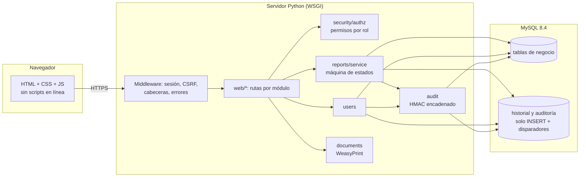
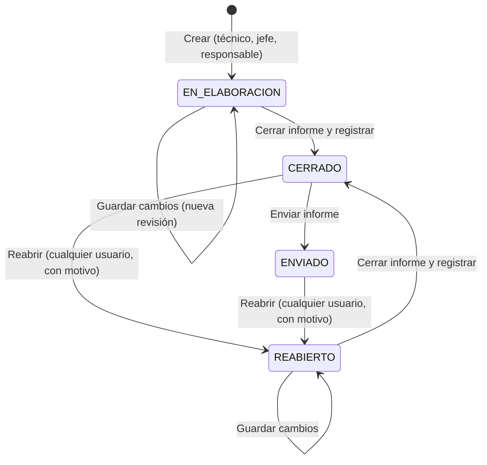
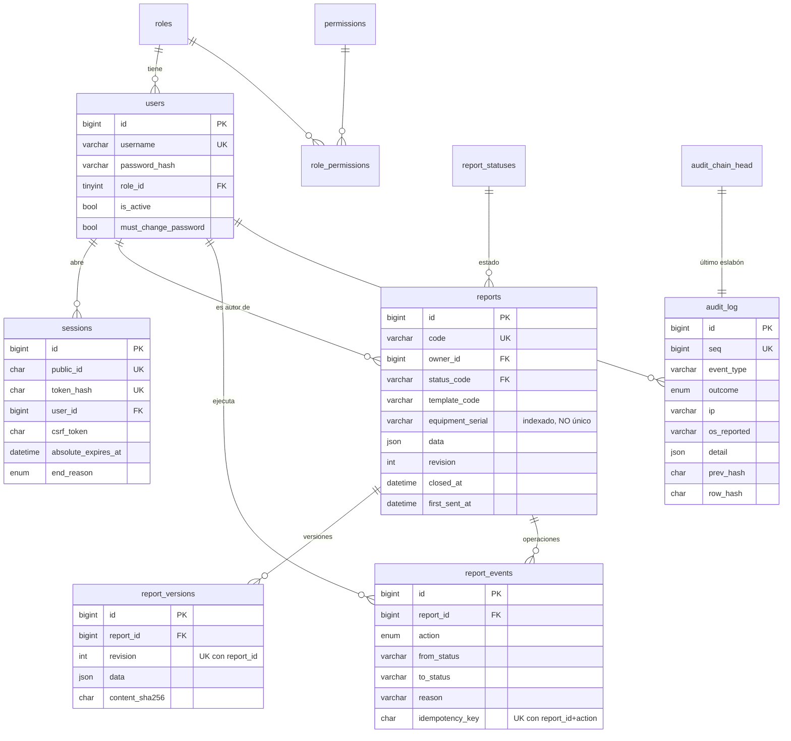

# Arquitectura

Los diagramas usan Mermaid (se ven en GitHub y en VS Code con la extensión «Markdown Preview Mermaid Support»).

## 1. Componentes

| Capa | Responsabilidad | Archivos |
|---|---|---|
| Presentación | Formularios, tablas, paneles y navegación por perfil | `templates/`, `static/` |
| Rutas | Validan la petición y llaman a los servicios; nunca escriben SQL de negocio | `web/` |
| Negocio | Estados, permisos por recurso, versiones, usuarios, documentos | `reports/`, `users.py`, `documents.py` |
| Seguridad | Sesiones, CSRF, contraseñas, autorización, datos del cliente | `security/` |
| Persistencia | Conexión, transacciones, migraciones, respaldo | `db.py`, `migrations/`, `backup.py` |

### Consistencia entre la operación y la auditoría

Cada operación crítica (crear, guardar, cerrar, enviar, reabrir, cambiar un rol, iniciar o cerrar sesión) escribe su evento de auditoría **en la misma transacción** que los datos. Si falla la auditoría, se revierte la operación completa; si falla la operación, no queda evento. Los eventos sin transacción propia (fallos de inicio de sesión, accesos denegados, descargas) se escriben en una transacción independiente **antes** de responder. Si esa escritura falla, la solicitud termina en error (falla cerrado): por ejemplo, un PDF no se entrega sin su registro.

## 2. Ciclo de vida del informe

- **Guardar** nunca cierra ni envía. Cada guardado con cambios crea una revisión en `report_versions`.
- **Cerrar** valida los campos obligatorios, persiste los datos definitivos y bloquea el contenido.
- **Enviar** es una operación distinta: solo es posible desde CERRADO y es idempotente mediante `op_id`.
- **Reabrir** exige un motivo de 10 caracteres como mínimo. No borra versiones ni eventos anteriores.
- La transición se valida tres veces: en Python (`reports/service.py`), en el `UPDATE ... WHERE status_code = <anterior>` y en el disparador `trg_reports_state_guard`, que además impide modificar el contenido de un informe CERRADO o ENVIADO.
- El bloqueo de fila (`SELECT ... FOR UPDATE`) y la columna `revision` evitan carreras y sobrescrituras entre usuarios.

## 3. Modelo entidad-relación

Tablas adicionales: `report_counters` (secuencia anual de identificadores), `system_settings` y `schema_migrations`.
Migración 0003: `report_attachments` (fotos y firmas por informe, LONGBLOB, solo inserción con retirada lógica; bloqueadas con el informe cerrado), `reopen_requests` (solicitudes de reapertura, como máximo una pendiente por informe), `users.id_number` (sustituye al correo; único y válido para iniciar sesión) y `reports.equipment_brand` (índice marca + serie).
Migración 0004: `reports.deleted_at/deleted_by/deletion_reason` (eliminación lógica por el responsable; los informes eliminados se excluyen en `visibility_clause`).
Migración 0005: teléfonos para WhatsApp, firmas persistentes del perfil, enlaces de invitación de un solo uso (72 horas) y permisos de consulta/edición/reapertura para todos los perfiles.
El número de serie del equipo **no** identifica al informe: un mismo equipo puede auditarse varias veces (comprobado por una prueba).

## 4. Rutas principales

| Ruta | Método | Permiso |
|---|---|---|
| `/login`, `/logout`, `/cuenta/contrasena` | GET/POST | — / sesión |
| `/cuenta/perfil`, `/cuenta/perfil/firma` | GET / POST | sesión propia |
| `/invitacion/<token>` | GET / POST | token de primer acceso válido |
| `/` (Inicio) | GET | `module.home` |
| `/informes`, `/informes/nuevo` | GET / POST | `module.reports`, `report.create` |
| `/informes/<id>` | GET | módulo de informes + visibilidad del recurso |
| `/informes/<id>/guardar` (accion=guardar\|cerrar) | POST | capacidad `edit`/`close` del recurso |
| `/informes/<id>/enviar` | POST | capacidad `send` |
| `/informes/<id>/reabrir` | POST | `report.reopen` |
| `/informes/<id>/solicitar-reapertura` | POST | `report.request_reopen` (autor) |
| `/informes/<id>/resolver-solicitud` | POST | `report.reopen` |
| `/informes/<id>/adjuntos[/<id>[/retirar]]` | POST / GET | capacidad `edit` / visibilidad |
| `/informes/<id>/autocompletar` | POST | capacidad `edit` (texto OCR → campos) |
| `/informes/importar`, `/informes/importar/plantilla.xlsx` | POST / GET | `report.create`, `report.import` |
| `/informes/<id>/eliminar`, `/informes/<id>/restaurar`, `/informes/eliminados` | POST / GET | `report.delete` |
| `/informes/plantilla.css` | GET | — (CSS de `resources/Plantilla_Informe_AJ_System.html`) |
| `/informes/<id>/pdf` | GET | `report.download` + visibilidad |
| `/consolidacion` | GET | `module.consolidation`, `report.view_sent` |
| `/registro`, `/registro/sesiones`, `/registro/verificar` | GET / POST | `module.audit_log`, `audit.read` / `audit.verify` |
| `/administracion/...` | GET/POST | `users.manage` |
| `/administracion/usuarios/<id>/firma` | POST | `users.manage`; solo cuentas con rol `TECNICO` |
